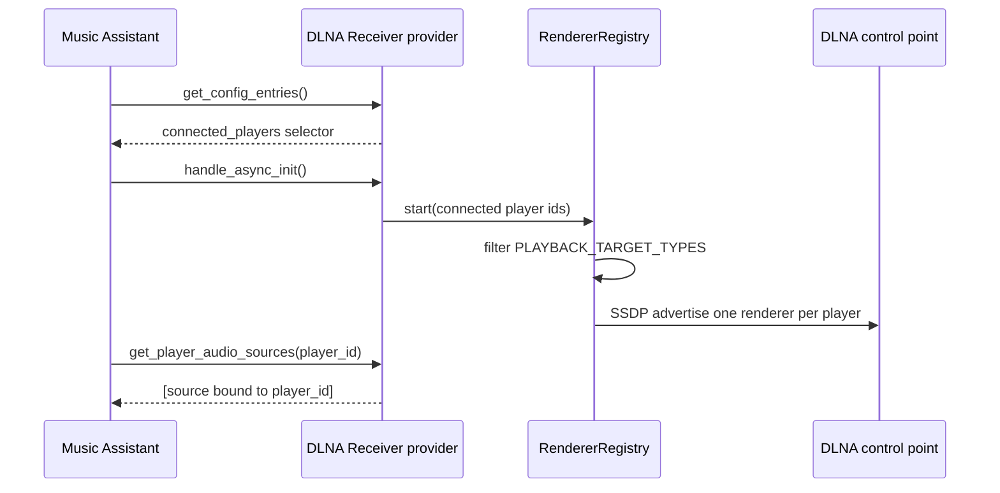

## Problem Statement

Every Music Assistant player currently sees every DLNA renderer source, a
restricted user can discover sources for players hidden from them, and display,
light or source-only clients receive renderers even though they cannot play
audio. Upstream review also requires the player-bound plugin model so the
renderer list is scoped to the player that owns it.

The provider must use Music Assistant's connected-player setting and expose only
the source bound to the requested player.

## Solution Summary

Replace the provider-local `target_players` option with Music Assistant's
`connected_players` entry, implement `get_player_audio_sources(player_id)`, and
limit renderer creation to playback-capable player types. Existing
`target_players` values are intentionally not migrated; users re-select players
once after upgrading.

## Acceptance Criteria

1. The provider config exposes `connected_players` instead of `target_players`.
2. `get_player_audio_sources("kitchen")` returns only the kitchen renderer source; an unknown player returns an empty list.
3. Display, light, visualizer and source clients never receive a renderer.
4. A player outside the configured connected-player list receives no renderer.
5. An empty connected-player list still exposes every eligible player.
6. The full test suite and `pre-commit run --all-files` pass.

## Test Plan

- Unit: `test_get_player_audio_sources_returns_only_the_bound_source`.
- Unit: `test_connected_player_options_are_sorted_and_keep_missing_selection`.
- Unit: `test_non_playback_players_do_not_get_renderers`.
- Unit: existing lifecycle tests for explicit targets and player add/remove.
- Manual: add the provider in Music Assistant, select one player, verify only
  that player's source appears in its source menu and in Live Inputs.

## Sequence Diagram

